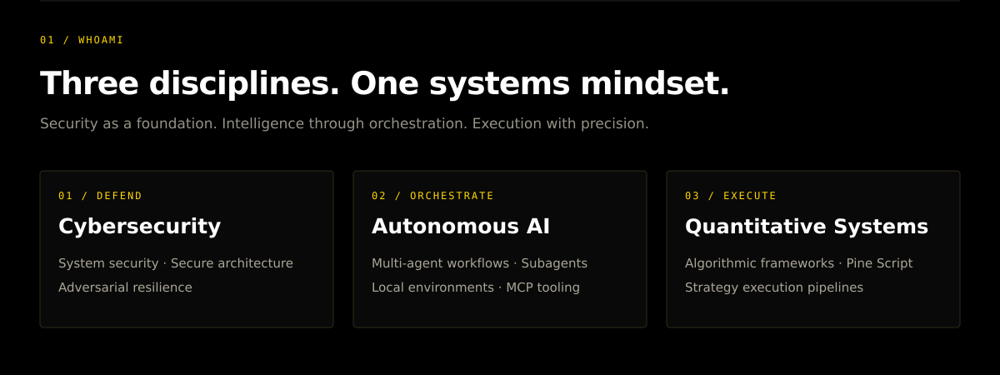
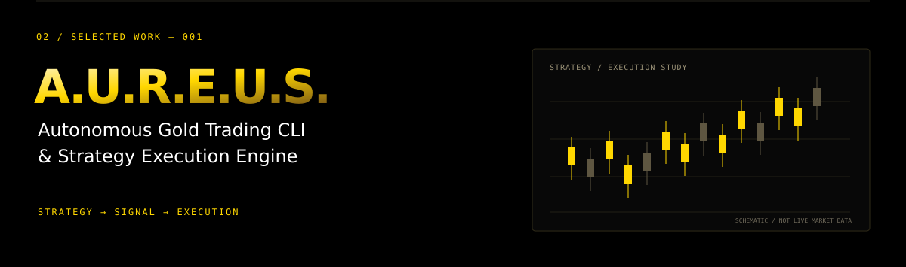
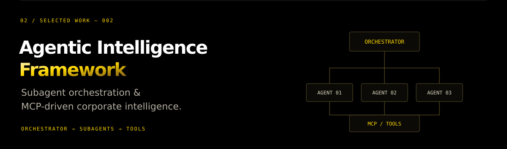
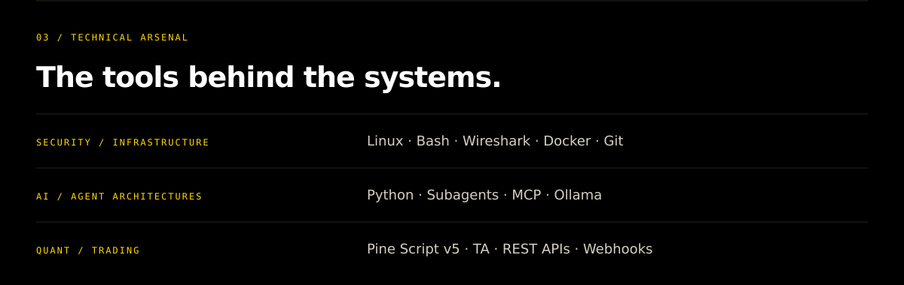
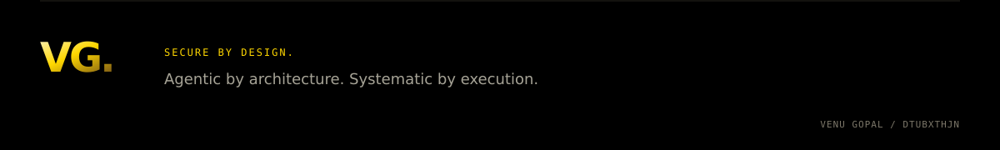

<!-- Custom artwork is stored in this repository; core content has no external image dependencies. -->

  
  
  
  
  
  

  <a href="https://github.com/Dtubxthjn?tab=repositories">Explore repositories ↗</a>
  &nbsp; · &nbsp;
  <a href="https://github.com/Dtubxthjn?tab=stars">Explore stars ↗</a>

GitHub activity

 

  
  

